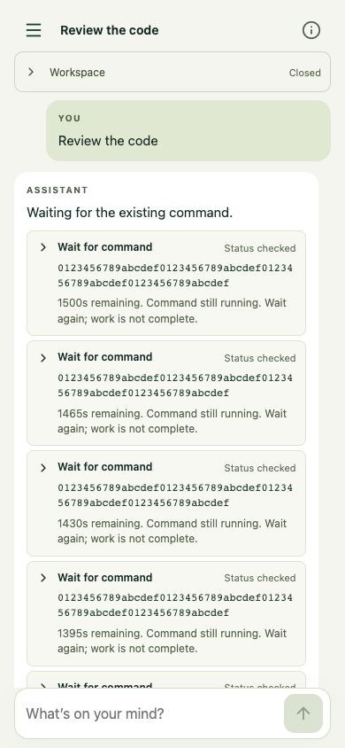
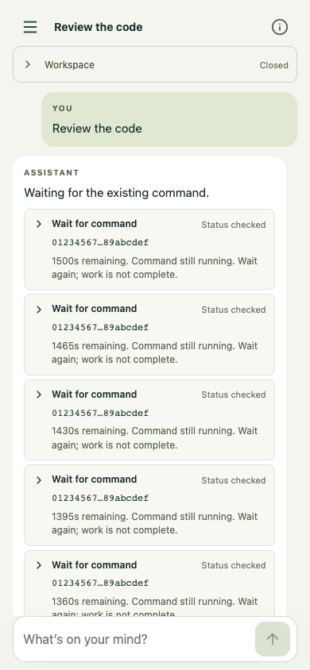

# Compact tool identifiers

Repeated run IDs in collapsed Wait for command cards now show eight leading and eight trailing characters. The same rule covers identifier-only context on workspace/process status, logs, and cancellation cards. Commands, paths, short identifiers, stored identifiers, and full input/output evidence are unchanged.

Expand a card to select the full identifier in its Input or Output. Legacy cards without Input expose an Identifier section. The preview title and accessible label retain the full context. Existing native selection/copy data stays exact; the browser check verifies selection without changing the host clipboard.

The attached user screenshot was inspected privately; all committed captures below use synthetic data. Baseline: 5aaf61df4cad49071aaef3fd760ddf3e66cf5858. At 390px and 320px the ID context shrinks from two lines (33.6px) to one (16.8px). Checks cover 390x844, 320x568, and 1280x900, expansion persistence, exact input/output selection, and horizontal overflow.

| Before (390px) | After (390px) |
| --- | --- |
|  |  |

[Expanded full evidence](mobile-expanded.png) · [Desktop](desktop-after.png)

Reproduce: `node tests/compact-identifiers.mjs`. These are local Chrome emulation captures with mocked APIs, not authenticated production or physical iPhone verification. No model requests are made.
