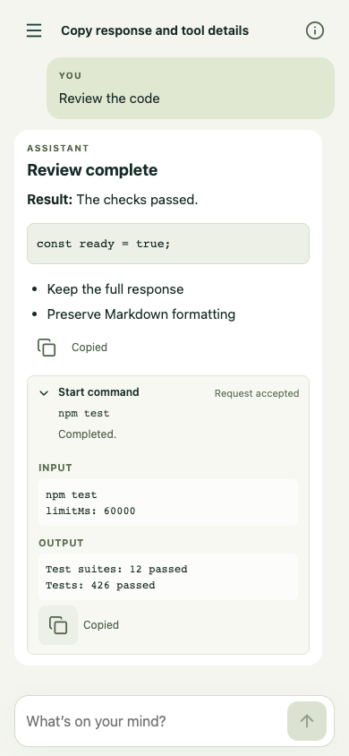
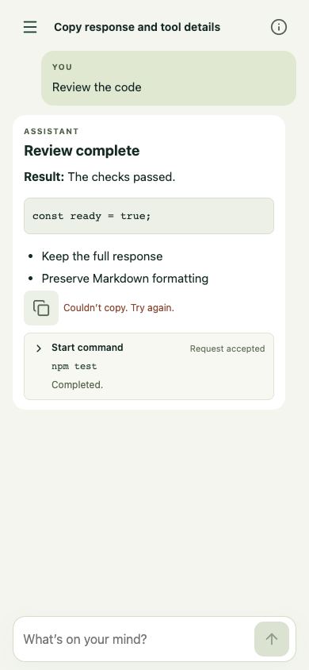

# Response and tool copy controls

Each assistant response with text has a copy icon below its text, before any tools. It copies exactly the canonical Markdown string, preserving code fences, lists, links, and line breaks. User messages, tool-only responses, and replacement interruption notices have no response-copy control. A streaming response is labelled Copy response so far; copying is a snapshot of the text at the click.

Each expanded tool has a separate Copy tool details control, outside its summary. It copies recorded tool identity/name, full call ID, state, context, arguments, output, diagnostic detail, and source metadata where available. It uses the supplied values before display slicing or compact ID formatting. Existing redaction and bounded history remain in force; upstream truncation flags produce explicit clipboard notes. Unknown raw tool names remain filtered. No unrecorded result is invented or fetched.

Clipboard writes happen only on a click. Pending duplicate clicks are ignored. Feedback appears only after the API settles; rejection/unavailability gives an error, with no automatic selection or navigation fallback. Rerenders retain state and keyboard focus, streaming changes clear stale success, and a pending copy that completes after text changes says Copied earlier version. Icon buttons have accessible labels, 44px targets, and live feedback. No host clipboard contents are read.

## Evidence

Local Chrome, synthetic data, mocked clipboard and APIs, at 390x844 and 1280x900. These captures show the two independent controls and failure feedback. Tests never modify the host clipboard.

| Assistant and expanded tool | Clipboard rejection |
| --- | --- |
|  |  |

[Desktop controls](desktop-expanded.png)

Reproduce: `node tests/copy-controls.mjs` (or set `CHROME_EXECUTABLE`). Coverage includes exact Markdown, no tool text in response copy, complete available tool evidence, compact-ID independence, pending/repeated clicks, API errors and absence, native disclosure state, focus through rerender/stream completion, visibility when collapsed, touch targets, and no selection/navigation side effects.

Physical iPhone clipboard permissions and authenticated live production UI were not tested. No deployment or model requests were made. The existing Worker fixture socket reset occurred once during local validation; the final full rerun passed without changing that fixture.
