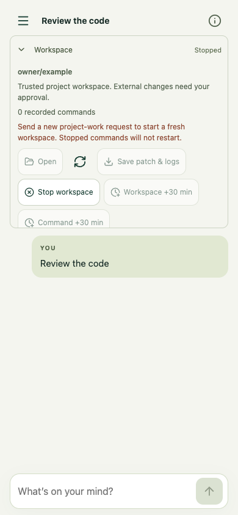
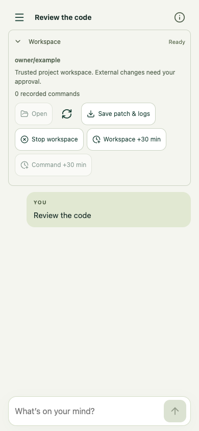

# Workspace activation after Stop

Issue #49 exposed two independent code paths: `workspace-auto-stop:<session>` was cleared only by manual Open, while the workspace header rendered Ready solely from the guest phase. A durable blocked intent plus an old ready guest therefore reproduced the reported error/header contradiction. The original screenshot does not establish the preceding stop sequence; this regression reconstructs the state locally.

A later admitted owner message now permits automatic project work. Submission itself starts no guest. The next new read/edit/exec can create a fresh clone of a cancelled/interrupted/failed predecessor. Old edits are not restored; ownership, historical operation identities, and prior artifact references remain pinned. Status/log/wait/export and reload/polling do not grant new intent or start a guest.

Workspace stop epochs are captured at HTTP arrival and persisted in admission receipts/reservations. A message queued before a newer Stop, receipt replay, or retry with a lost response cannot clear that newer Stop. Re-authorizing work preserves the epoch so older pending activations remain cancelled. Reservation and pre-dispatch checks both retain the original generation. An unfinished stop on a stale ready guest is cleaned up before new work; stopping cleanup requires waiting, with no command dispatched.

The header respects blocked activation even when the guest phase says ready. Sending a new message refreshes the panel. Failed Stop requests show unavailable status rather than retaining Ready. Model instructions explain the fresh-request boundary and prohibit command replay.

## UI evidence

All screenshots use synthetic data and mocked APIs in local Chrome. They verify presentation, submit-triggered refresh, no manual Open calls, and reload behavior at 390x844 and 1280x900. They do not prove Cloudflare container startup or authenticated production UI behavior.

| Blocked activation with stale ready phase | Ready successor |
| --- | --- |
|  |  |

[Desktop stopped](desktop-stopped.png) · [Desktop ready](desktop-ready.png)

Run `node tests/workspace-resume.mjs` (or set `CHROME_EXECUTABLE`). Coordinator tests use the actual lifecycle controller with a fake guest adapter. Signed-owner Worker route tests use Miniflare with simulated SDK effects; an additional composed admission/coordinator test covers queued intent, lost responses, and reconstruction. No production model/container requests are made. Issue #50 is unchanged.
